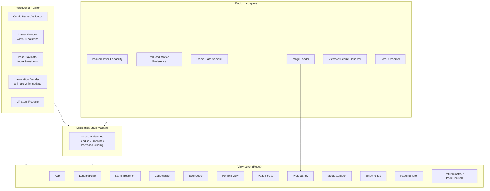
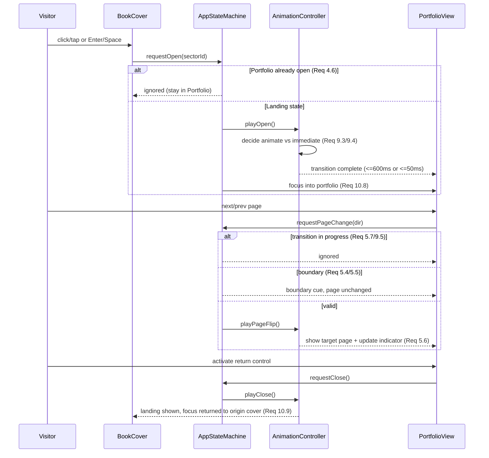
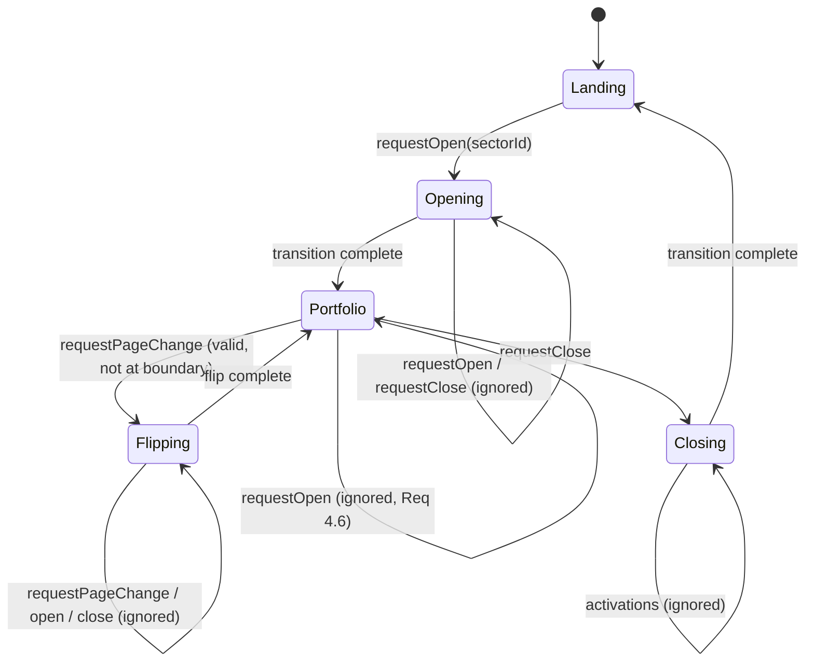

# Design Document

## Overview

The Portfolio Coffee Table is a client-side, statically-hosted personal portfolio website for Giuliana C. Bilbao. It renders a scrollable landing page with a fixed top-left name treatment over a responsive grid ("coffee table") of book covers. Each cover represents a configurable Sector. Hovering (fine pointer) lifts a cover; clicking or tapping opens an editorial black-and-white "book" portfolio with binder rings, page-flip navigation, a page-position indicator, and a return control.

The design prioritizes:

- **Static/client-side delivery** — no server runtime required; deployable to any static host (GitHub Pages, Netlify, S3/CloudFront). All content is bundled or fetched as static assets. (Req 7)
- **Configuration-driven content** — the Sector set (1–12 books) is derived from a single configuration source, rendered in config order, with graceful degradation when config is missing or malformed. (Req 1.2, 1.5, 7.1–7.4)
- **Performance-aware animation** — a small animation controller enforces a 600ms budget, honors reduced-motion, and falls back to immediate state changes when frame rate drops below 30fps. (Req 9)
- **Accessibility by construction** — keyboard focus order, Enter/Space activation, visible focus indicators, text alternatives, and focus management on open/close. (Req 10)

### Technology Choices

| Concern | Choice | Rationale |
|---|---|---|
| Framework | **React + TypeScript** (via Vite) | Component model matches the cover/portfolio/page decomposition; TypeScript enforces the config data model; static build output. |
| Styling | **CSS Modules + CSS custom properties** | Scoped styles per component, native support for responsive grids and `prefers-reduced-motion`, no runtime CSS-in-JS cost. |
| Layout | **CSS Grid** with breakpoint-driven column counts | Native responsive re-layout; avoids JS-driven layout for the common case. (Req 8) |
| Animation | **Web Animations API (WAAPI) / CSS transitions** wrapped by an `AnimationController` | Gives programmatic control over duration budgets, cancellation, and frame-rate sampling via `requestAnimationFrame`. (Req 9) |
| State | **React state + a small finite-state machine** for view/transition state | Makes "one book lifted", "one portfolio open", and "ignore re-entrant transitions" explicit and testable. (Req 3.3, 4.6, 5.7, 9.5) |
| Testing | **Vitest + React Testing Library + fast-check** | Vitest for unit/integration, fast-check for property-based tests of pure logic. |

Because the site is static and client-side, "the System" in the requirements maps to the browser-hosted application. There is no backend to fail; the configuration source is a static asset (bundled JSON/TS module or fetched JSON file).

## Architecture

The application is organized into four layers: a **pure domain/logic layer** (config parsing, layout selection, page navigation, animation-decision logic), a **state layer** (application finite-state machine), a **view layer** (React components), and a **platform-adapter layer** (pointer/hover detection, reduced-motion detection, frame-rate sampling, image loading). The pure layer contains no DOM dependencies, which is where property-based testing concentrates.



### Runtime Flow: Open / Browse / Close



### Application State Machine

The core coordination is a finite-state machine. Modeling it explicitly makes the "ignore re-entrant transitions" and "only one open portfolio" rules structural rather than incidental.



States: `Landing`, `Opening`, `Portfolio`, `Flipping`, `Closing`. Transitions accepted only from stable states (`Landing`, `Portfolio`); activations arriving during transient states (`Opening`, `Flipping`, `Closing`) are ignored (Req 4.6, 5.7, 9.5).

## Components and Interfaces

### View Components

- **App** — Root. Owns the `AppStateMachine`, wires platform adapters, provides config to the tree, and renders either `LandingPage` (always in the DOM background) and, when open, `PortfolioView`.
- **LandingPage** — Scroll container. Hosts `NameTreatment` (fixed top-left) and `CoffeeTable`. Manages the scroll observer that suspends/restores cover interactivity. (Req 1, 2)
- **NameTreatment** — Renders "Giuliana C. Bilbao" anchored top-left, position fixed relative to the landing viewport, with ≥4.5:1 contrast. (Req 1.1, 1.3, 10.7)
- **CoffeeTable** — CSS Grid container. Renders one `BookCover` per configured Sector in config order; handles empty state. (Req 1.2, 1.5, 7.2, 8)
- **BookCover** — Focusable/activatable cover. Applies lift transform, focus indicator, text alternative; emits `onActivate(sectorId)`. (Req 1.4, 3, 10.1–10.3, 10.5)
- **PortfolioView** — Opened book. Renders `BinderRings`, current `PageSpread`, `PageIndicator`, `PageControls`, `ReturnControl`, and `MetadataBlock`; owns focus trap and restoration. (Req 4, 5, 6, 10.4, 10.8, 10.9)
- **PageSpread** — Renders the `Project_Entry` items assigned to the current page, or the empty-state message. (Req 5.1, 6.1, 7.3)
- **ProjectEntry** — Title, description, one or more images (via `ImageWithPlaceholder`). (Req 6.2, 10.6)
- **MetadataBlock** — Location, date, optional contact. (Req 6.3–6.5)
- **ImageWithPlaceholder** — Wraps image load with a 10s timeout and error fallback preserving layout footprint. (Req 6.7)
- **BinderRings**, **PageIndicator**, **PageControls**, **ReturnControl** — Editorial chrome and navigation controls. (Req 6.6, 5.6, 4.4)

### Domain / Adapter Interfaces

```typescript
// ---- Configuration parsing (pure) ----
interface ConfigParseResult {
  ok: boolean;
  sectors: Sector[];      // empty when ok === false or zero sectors configured
  errors: string[];       // human-readable validation messages
}
function parseSectorConfig(raw: unknown): ConfigParseResult; // Req 7.1, 7.2, 7.4

// ---- Responsive layout (pure) ----
type ColumnTier = 1 | 2 | 3; // 3 means "at least 3"
function selectColumnCount(viewportWidthPx: number): number; // Req 8.1-8.3

// ---- Page navigation (pure) ----
interface PageNavState { currentIndex: number; totalPages: number; }
type NavIntent = 'next' | 'prev';
interface NavOutcome { state: PageNavState; atBoundary: boolean; }
function navigate(state: PageNavState, intent: NavIntent): NavOutcome; // Req 5.2-5.6

// ---- Animation decision (pure) ----
interface AnimationEnv {
  reducedMotion: boolean;     // Req 9.3
  animationAvailable: boolean;// Req 4.3
  degraded: boolean;          // set true once fps < 30 observed (Req 9.4)
}
type AnimationMode = 'animated' | 'immediate';
function decideAnimationMode(env: AnimationEnv): AnimationMode; // Req 4.3, 9.3, 9.4

// ---- Lift state (pure reducer) ----
type LiftState = { liftedId: string | null };
type LiftEvent =
  | { type: 'pointerEnter'; id: string }
  | { type: 'pointerLeave'; id: string }
  | { type: 'suspend' }; // scrolling
function liftReducer(state: LiftState, e: LiftEvent, hoverCapable: boolean): LiftState; // Req 3

// ---- Application state machine (pure transition fn) ----
type ViewState = 'Landing' | 'Opening' | 'Portfolio' | 'Flipping' | 'Closing';
interface AppState { view: ViewState; openSectorId: string | null; originCoverId: string | null; }
type AppEvent =
  | { type: 'requestOpen'; sectorId: string }
  | { type: 'openComplete' }
  | { type: 'requestPageChange'; intent: NavIntent }
  | { type: 'flipComplete' }
  | { type: 'requestClose' }
  | { type: 'closeComplete' };
function appTransition(state: AppState, e: AppEvent): AppState; // Req 4.6, 5.7, 9.5

// ---- Platform adapters (impure, thin) ----
interface HoverCapability { supportsHover(): boolean; }        // Req 3.5, 3.6
interface ReducedMotion { prefersReducedMotion(): boolean; }   // Req 9.3
interface FrameRateSampler { sample(cb: (fps: number) => void): () => void; } // Req 9.2, 9.4
interface ImageLoader { load(src: string, timeoutMs: number): Promise<'loaded' | 'failed'>; } // Req 6.7
```

### Animation Controller

The `AnimationController` sits between the state machine and the DOM. Its responsibilities:

1. Query `decideAnimationMode(env)` before every transition. If `immediate`, apply the target state within 50ms with no interpolation. (Req 4.3, 9.3, 9.4)
2. When animating, cap duration at ≤600ms and target 60fps via WAAPI. (Req 9.1, 9.2)
3. Sample frame rate during transitions; if any transition sustains <30fps, set `env.degraded = true` so subsequent transitions use immediate mode. (Req 9.4)
4. Emit a completion event exactly once per transition; reject/ignore new play requests while a transition is active (enforced together with the state machine). (Req 9.5)

## Data Models

Content is configuration-driven and static. The configuration source is a typed module/JSON validated by `parseSectorConfig`.

```typescript
interface SectorConfig {
  sectors: Sector[]; // rendered in array order (Req 7.2)
}

interface Sector {
  id: string;                 // stable unique key
  title: string;              // unique, non-empty; used as Book_Cover title (Req 1.4)
  coverStyleId: string;       // cover styling identifier (Req 7.1)
  altText: string;            // non-empty text alternative for the cover (Req 10.5)
  portfolio: PortfolioContent;
  metadata: MetadataContent;
}

interface PortfolioContent {
  projects: ProjectEntry[];   // may be empty -> empty-state message (Req 7.3)
}

interface ProjectEntry {
  title: string;              // non-empty (Req 6.2)
  description: string;        // non-empty (Req 6.2)
  images: ProjectImage[];     // at least one (Req 6.2)
}

interface ProjectImage {
  src: string;
  alt: string;                // non-empty, meaningful (Req 10.6)
  width: number;              // intrinsic footprint for placeholder sizing (Req 6.7)
  height: number;
}

interface MetadataContent {
  location: string;           // required (Req 6.3)
  date: string;               // required (Req 6.3)
  contact?: string;           // optional (Req 6.4, 6.5)
}
```

### Pagination Model

Projects are distributed across pages by a pure `paginate(projects, projectsPerPage)` function producing an ordered list of `Page` objects. Each `Page` holds the project entries shown on that spread. `totalPages = pages.length` (minimum 1: an empty portfolio yields a single empty-state page). This keeps the page indicator (Req 5.6) and navigation (Req 5) driven by pure data.

```typescript
interface Page { index: number; projects: ProjectEntry[]; isEmptyState: boolean; }
function paginate(projects: ProjectEntry[], projectsPerPage: number): Page[]; // Req 5.1, 6.1, 7.3
```

### Validation Rules (parseSectorConfig)

A configuration is **valid** when it is an object with a `sectors` array of length 0–12, every sector has non-empty `id`, `title`, `coverStyleId`, and `altText`, all titles are unique, and every present `ProjectEntry` has non-empty title, non-empty description, and ≥1 image with non-empty `alt`. Zero sectors is valid and yields an empty coffee table (Req 1.5, 7 boundary). Anything else (non-object, `sectors` not an array, length >12, missing/empty required fields, duplicate titles, malformed projects) makes the result `ok: false` with `sectors: []`, so the landing page renders the name with no covers (Req 7.4).

## Correctness Properties

*A property is a characteristic or behavior that should hold true across all valid executions of a system — essentially, a formal statement about what the system should do. Properties serve as the bridge between human-readable specifications and machine-verifiable correctness guarantees.*

The following properties target the pure domain layer (config parsing, layout selection, page navigation, lift/state reducers, animation-mode decision, pagination, and render-completeness of pure render functions). UI-only concerns (fixed positioning, styling, exact colors, 60fps, timer thresholds) are covered by example, edge-case, and smoke tests in the Testing Strategy rather than by properties.

### Property 1: Valid configuration renders covers faithfully

*For any* valid Sector configuration with N sectors (0 ≤ N ≤ 12), `parseSectorConfig` returns `ok: true` and the Coffee_Table renders exactly N Book_Cover elements in configuration order, where every rendered cover has a non-empty title, a non-empty accessible text alternative, is keyboard-focusable, and all cover titles are unique.

**Validates: Requirements 1.2, 1.4, 7.1, 7.2, 10.1, 10.5**

### Property 2: Malformed or unavailable configuration degrades gracefully

*For any* input that is not a valid Sector configuration (non-object, missing/non-array `sectors`, more than 12 sectors, empty required fields, duplicate titles, or malformed projects), `parseSectorConfig` returns `ok: false` with an empty `sectors` list, and the Landing_Page renders the Name_Treatment with zero Book_Cover elements and without throwing. The zero-sector configuration is a valid boundary that likewise yields an empty Coffee_Table with the name shown.

**Validates: Requirements 1.5, 7.4**

### Property 3: At most one cover is lifted (single-lift invariant)

*For any* sequence of pointer/scroll events applied to `liftReducer`, at most one Book_Cover is in the lifted state at any time: entering a cover on a hover-capable device makes it the sole lifted cover (latest enter wins, returning any previously lifted cover to rest), leaving the lifted cover clears the lift, and when the device is not hover-capable or a `suspend` (scroll) event is active the lifted set is empty.

**Validates: Requirements 3.1, 3.2, 3.3, 3.4, 3.5, 2.2**

### Property 4: At most one portfolio open and transient states ignore activations (re-entrancy invariant)

*For any* sequence of application events applied to `appTransition`, at most one Portfolio_View is open at any time, and any `requestOpen`, `requestClose`, or `requestPageChange` received while the machine is in a transient state (`Opening`, `Flipping`, or `Closing`) — or a `requestOpen` received while already in `Portfolio` — leaves the target view and target page unchanged.

**Validates: Requirements 4.6, 5.7, 9.5**

### Property 5: Open and close reach the correct target state

*For any* Sector, issuing `requestOpen(sectorId)` from the `Landing` state drives the machine to `Portfolio` with `openSectorId === sectorId`, and subsequently issuing `requestClose` drives the machine back to `Landing` with `openSectorId === null`.

**Validates: Requirements 4.1, 4.5**

### Property 6: Close returns focus to the originating cover (focus round-trip)

*For any* Sector opened from a Book_Cover in the `Landing` state, the machine preserves the originating cover's id throughout the open→browse→close cycle, so that on close the focus-restore target equals the id of the Book_Cover that originated the Portfolio_View.

**Validates: Requirements 10.9**

### Property 7: Responsive column selection matches viewport tier

*For any* viewport width w, `selectColumnCount(w)` returns 1 when w < 640, exactly 2 when 640 ≤ w < 1024, and at least 3 when w ≥ 1024.

**Validates: Requirements 8.1, 8.2, 8.3**

### Property 8: Page navigation stays in range with correct boundaries

*For any* `PageNavState` with `totalPages ≥ 1` and `0 ≤ currentIndex < totalPages`: a Portfolio_View opens at `currentIndex === 0`; `navigate(state, 'next')` increments the index by 1 with `atBoundary === false` when not on the last page and otherwise leaves the index unchanged with `atBoundary === true`; `navigate(state, 'prev')` decrements by 1 with `atBoundary === false` when not on the first page and otherwise leaves the index unchanged with `atBoundary === true`; and after any navigation the resulting index remains in range so the indicator reports `(currentIndex + 1, totalPages)`.

**Validates: Requirements 5.1, 5.2, 5.3, 5.4, 5.5, 5.6**

### Property 9: Pagination conserves and orders project content

*For any* list of Project_Entry items, concatenating the `projects` of the pages produced by `paginate` yields the original list in the original order; a non-empty list produces at least one page whose combined entries contain every project; and an empty list produces exactly one page with `isEmptyState === true`.

**Validates: Requirements 6.1, 7.3**

### Property 10: Portfolio content renders completely

*For any* valid Project_Entry, its rendered output contains the title text, the description text, and at least one image element each carrying a non-empty `alt` attribute; and *for any* Metadata_Block content, the rendered block contains the location and date values, contains the contact value exactly when contact is provided, and contains no contact entry when contact is absent.

**Validates: Requirements 6.2, 6.3, 6.4, 6.5, 10.6**

### Property 11: Animation mode falls back deterministically

*For any* `AnimationEnv`, `decideAnimationMode` returns `immediate` whenever the animation system is unavailable, the visitor prefers reduced motion, or a degraded (sub-30fps) condition has been observed, and returns `animated` only when none of these hold.

**Validates: Requirements 4.3, 9.3, 9.4**

### Property 12: Failed image load preserves layout footprint

*For any* Project_Entry image with intrinsic width and height, when the image fails to load or times out, the substituted placeholder occupies the identical width and height footprint, so surrounding Project_Entry content retains its position and size.

**Validates: Requirements 6.7**

## Error Handling

| Condition | Handling | Requirement |
|---|---|---|
| Configuration source unavailable (fetch fails) or malformed (schema invalid) | `parseSectorConfig` returns `ok: false, sectors: []`; App renders Landing with Name_Treatment and empty Coffee_Table; validation errors logged to console for the owner. | 7.4, 1.5 |
| Zero sectors configured | Treated as a valid empty set; empty Coffee_Table rendered, no error. | 1.5, 7 boundary |
| Sector with no portfolio content | `paginate` yields a single empty-state page; Portfolio_View shows a "content not yet available" message. | 7.3 |
| Project image load error or >10s timeout | `ImageWithPlaceholder` swaps in a placeholder of identical footprint; layout preserved. | 6.7 |
| Animation system unavailable/disabled | `decideAnimationMode` → `immediate`; open/close/flip apply target state directly within the immediate budget. | 4.3, 9.3 |
| Sustained frame rate < 30fps | Sampler sets `env.degraded = true`; subsequent transitions use immediate mode. | 9.4 |
| Re-entrant open/close/page-flip during a transition | State machine ignores the activation; in-progress transition completes. | 4.6, 5.7, 9.5 |
| Rapid pointer movement across covers | Lift reducer enforces single-lift; latest enter wins, previous rests. | 3.3, 3.4 |
| Scroll in progress | `suspend` clears lift and blocks activation; restored after 150ms quiet. | 2.2, 2.3 |

Guiding principle: the Name_Treatment must always render regardless of content or configuration failures, and no content/config error may crash the Landing_Page.

## Testing Strategy

The strategy is dual: **property-based tests** verify the universal properties above across the pure domain layer, and **example/integration/edge-case tests** verify concrete UI behavior, wiring, timing, styling, and accessibility that are not amenable to universal quantification.

### Property-Based Tests

- **Library:** `fast-check` with Vitest. Property-based testing is NOT implemented from scratch.
- **Iterations:** each property test runs a minimum of 100 generated cases (`fc.assert(..., { numRuns: 100 })`).
- **Tagging:** each property test is tagged with a comment in the form
  `// Feature: portfolio-coffee-table, Property {number}: {property_text}`.
- **Coverage:** exactly one property-based test per correctness property (Properties 1–12).
- **Generators:** custom arbitraries for valid Sector configs (0–12 sectors, unique titles), malformed inputs (arbitrary JSON, oversized arrays, empty fields, duplicate titles), pointer/scroll event sequences, application event sequences, viewport widths (spanning all three tiers and boundaries 639/640/1023/1024), `PageNavState` values, project lists (including empty), `AnimationEnv` combinations, and image dimensions.

### Example / Unit Tests

- Name_Treatment renders "Giuliana C. Bilbao" anchored top-left (1.1, 1.3).
- Landing container is a vertical scroll container; small content requires no scroll (2.1, 2.4).
- Scroll-quiet debounce restores interactivity after 150ms and not before, using fake timers (2.3).
- Hover enabled on a hover-capable device even when touch is present (3.6).
- Keyboard Enter/Space on a focused cover opens the portfolio (10.2); next/prev/return controls are focusable and Enter/Space-activatable (10.4); return control present in every page state (4.4).
- Focus moves into the Portfolio_View on open (10.8).
- Editorial styling and BinderRings render in the Portfolio_View (6.6).
- Contrast checks: focus indicator ≥ 3:1 (10.3), Name_Treatment ≥ 4.5:1 (10.7), computed from the chosen palette.
- Animation durations are all configured ≤ 600ms (9.1); open animates then completes within budget with fake timers (4.2).

### Edge-Case Tests

- Zero-sector configuration renders name with empty table (1.5).
- 10-second image timeout path triggers placeholder swap (6.7 timeout branch).
- Boundary widths 639/640/1023/1024 map to the correct column tier (8.1–8.3 boundaries).

### Integration Tests

- Resize across 640 and 1024 boundaries re-arranges columns within 500ms (8.4).
- No horizontal overflow beyond viewport width on Landing and Portfolio views (8.5).
- Full open → page-flip → close cycle returns focus to the originating cover (10.8, 10.9 end-to-end).

### Smoke / Manual

- Sustained ≥60fps during lift/flip/open-close (9.2) — verified via lightweight transform/opacity animations and manual/performance profiling; not asserted in automated unit tests.
